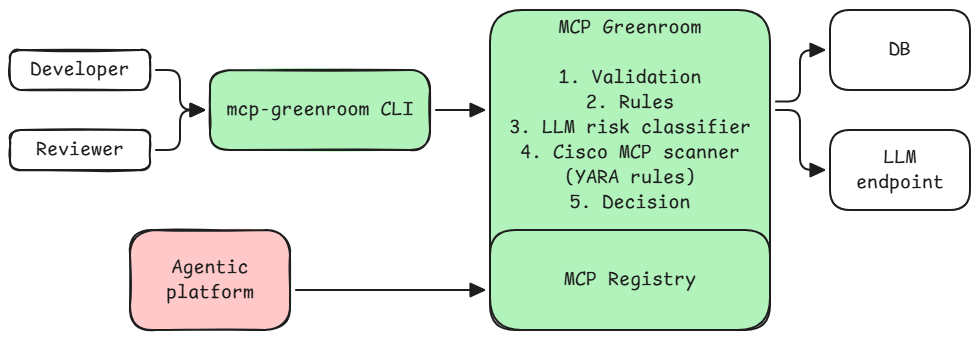

# MCP Greenroom: vetted registry for MCP servers

## What is MCP Greenroom?

MCP Greenroom is a self-managed MCP registry with a built-in validation and approval pipeline.
It provides an in-house intake and risk review for MCP servers, and publishes the approved list in the registry for coding agents and development environments.

## Why MCP Greenroom?

An MCP server gives a coding agent new tools, and the agent reads each tool's description as instructions. A poisoned description is an attack path. A regulated enterprise must be able to control what MCP servers are available for the developers via a curated registry, with a submission approval process, evidence, and policy.

## Technology stack

- **Python 3.12, uv** 
- **FastAPI, uvicorn, Pydantic v2** 
- **SQLAlchemy 2 on SQLite.**
- **Cisco AI MCP Scanner 4.8.7 (YARA engine)**

## How it works


1. A developer submits a specific version of an MCP server via the `mcp-greenroom` CLI.
2. The `mcp-greenroom` CLI sends the submission to the service.
3. The MCP Greenroom service validates it, runs its check rules, obtains an LLM risk classifier score, and runs the Cisco MCP Scanner (YARA rules).
4. The MCP Greenroom decides to reject the submission, approve it by policy, or assign it to a human reviewer.
5. A reviewer approves or declines the submission.
6. If the version is approved, it is published to the MCP Greenroom registry.
7. An agentic platform reads the registry and allows only approved MCP servers.

## Workflow
```text
submit -> validate -> rules -> scanner -> classifier -> decide -> (human review) -> publish -> GET /v0.1/servers
```
Rules run before the classifier, and the classifier can escalate a case but never clear one. Every decision leaves an append-only audit record. By default the classifier replays recorded model responses, so the workflow and every check run from a clean checkout with no credentials and no network.

## Prerequisites

Tested on WSL 2 with Ubuntu 24.04:

- [uv](https://docs.astral.sh/uv/) (tested with 0.13.8). It installs every Python dependency from `uv.lock`.
- Python 3.12, pinned in `.python-version` (tested with 3.12.3).
- git and bash.
- Optional: Docker with Compose, for the container (tested with 29.7.2).

No API key, no account and no network access beyond installing packages.

## Setup

```sh
git clone https://github.com/coal-corridor/mcp-greenroom.git
cd mcp-greenroom
uv sync
```

## Run

```sh
make run
```

- The API listens on `http://127.0.0.1:8000`. 

- The classifier replays recorded model answers and the scanner runs offline.

- Every setting has a safe default.

## Docker
`docker compose up --build` serves the same API on `127.0.0.1:8000`.

## Demo
To see everything at once, `./scripts/demo.sh` starts its own service on port 8765, walks the main path and the five safe failures with the CLI, checks each exit code and stops the service.

## Verification

- `./scripts/verify.sh` - lint, type check, tests and the classifier evaluation gate, with no network and no credentials, exits non-zero if any stage fails 
- `./scripts/verify.sh quick` - runs lint and types only
- `lint`, `types`, `test` and `eval` run one stage

## Example workflow

The main path: a developer submits a benign, read-only server, it is approved by policy and listed, and a client simulator allows it while blocking an unlisted one.

 The input is [`sample-data/servers/payments-readonly.json`](sample-data/servers/payments-readonly.json): a `server.json` record (`com.examplebank/payments-readonly` 1.2.0, one npm package) and two tools, `get_balance` and `list_payments`.

With `make run` in another terminal:

```text
$ uv run mcp-greenroom submit sample-data/servers/payments-readonly.json --token dev-dana

✓ approved  com.examplebank/payments-readonly 1.2.0  tier low
  policy.tier_low: Tier low, every risk score below 0.20, no rule or scanner match.
Next: mcp-greenroom status 2c5c37e7-d77a-45a8-8841-c8b779cb95ae
(exit 0)

$ uv run mcp-greenroom list

  com.examplebank/payments-readonly 1.2.0
1 approved version(s).
Next: mcp-greenroom client-check CONFIG, to see what a client would allow
(exit 0)

$ uv run mcp-greenroom client-check sample-data/client-configs/amp-settings.json

Simulation of Amp's documented registry check, not Amp itself.
✓ allowed  payments  npm package @examplebank/payments-readonly-mcp is listed
✗ blocked  notes  package is not on the registry list
Next: submit the blocked server with mcp-greenroom submit FILE, or remove it from the config
(exit 20)
```

- `dev-dana`, `dev-riley` and `dev-sam` are stub tokens that work only in the dev environment; *riley* and *sam* are reviewers. 
- Exit codes: 0 done or approved, 1 operational failure, 2 usage error, 10 in human review, 20 rejected, refused or blocked. 
- Safe failures are in the demo output in [`evidence/verify.md`](evidence/verify.md).

## Known limitations

- Vets the tools a submitter declares, not what the running server exposes.
- An approval is not bound to the package bytes: the fingerprint covers the manifest and the tool definitions only.
- By default the classifier knows only the recorded tools. Any other tool goes to a human. The recordings come from one model, `claude-haiku-5-5`, and one prompt version.
- The evaluation set is 41 synthetic cases. It proves the decision logic on recorded answers, not the model's accuracy in general.
- Stub identities, SQLite, one process.
- An approved version cannot be withdrawn.
- The degraded list has no expiry.
- Amp's check matches package name and registry type, not version, so per-version approval is exact here and not at the client. The client simulator follows public documentation and was never run against Amp or Copilot.
- Only `GET /v0.1/servers` of the registry API is served. No stretch item was built.
- Items deferred from the code reviews are listed in [`ROADMAP.md`](ROADMAP.md), with the rest of the route.

## Specs and roadmap

The spec the slice was built against is [`docs/specs/mcp-greenroom.md`](docs/specs/mcp-greenroom.md), with one child spec per area in [`docs/specs/`](docs/specs/). 

The roadmap is [`ROADMAP.md`](ROADMAP.md).

## Repository structure

| Path | Holds |
| --- | --- |
| `src/mcp_greenroom/` | The service and the CLI: `api/`, `vetting/`, `risk/`, `scanner/`, `store/`, `cli.py`, `client_sim.py`, and the shared `config.py`, `logging.py`, `models.py`, `interfaces.py` |
| `tests/` | `unit/` (vetting), `api/`, `contract/`, `failure/` (registry), `e2e/` (CLI and client simulator), `shared/`, `structure/` |
| `evals/` | The labelled evaluation set, the gate, the recorder, the recordings and the last report |
| `sample-data/` | The five named sample servers and a sample Amp client config. Some descriptions are hostile on purpose |
| `contracts/` | The upstream registry OpenAPI document and `server.json` schema, pinned with source and sha256 |
| `scripts/` | `verify.sh` (the one check command) and `demo.sh` |
| `deploy/`, `Dockerfile`, `docker-compose.yml` | The container, and the production shape in words |
| `evidence/` | The evidence pack, the session log and raw command output |
| `docs/` | The spec, its notes, the references and the target structure |
| `briefs/`, `handoff/` | One brief per build phase and area; one handoff note per session and one review report per area |
| `.claude/`, `CLAUDE.md`, `AGENTS.md` | The agent harness: settings, hooks, skills and the reviewer agent |
| `.github/workflows/ci.yml` | The pull request checks |

## Third-party components

Licences as read from each installed package's metadata on 17 Nov 2026.

| Component | Version | Licence | Role |
| --- | --- | --- | --- |
| Cisco MCP Scanner (`cisco-ai-mcp-scanner`) | 4.8.7, pinned | Apache 2.0 (from its LICENSE file) | YARA engine only, static mode, offline. Its model judge and the vendor API are not used |
| `yara-python` | 4.5.4 | Apache 2.0 | Rule engine under the scanner |
| `litellm` | 1.93.2 | MIT | Pulled in by the scanner, never called. Two advisories waived, see `evidence/decisions.md` |
| FastAPI, uvicorn | 0.163.1, 0.54.0 | MIT, BSD-3-Clause | HTTP API |
| Pydantic, pydantic-settings | 2.14.3, 2.16.3 | MIT | Models and configuration |
| SQLAlchemy | 2.1.9 | MIT | Store |
| Typer, Rich | 0.29.1, 15.0.0 | MIT | CLI |
| httpx | 0.28.1 | BSD-3-Clause | CLI client and live classifier provider |
| jsonschema, PyYAML | 4.26.0, 6.0.3 | MIT | Schema checks against the pinned upstream documents |

The pinned upstream documents in `contracts/` come from the MCP registry project; see `contracts/README.md` for their sources.
